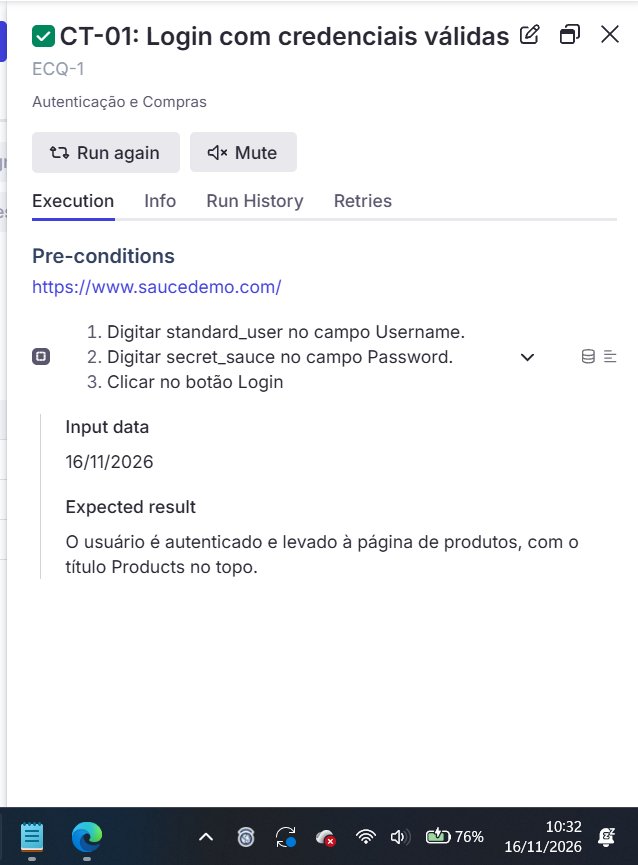
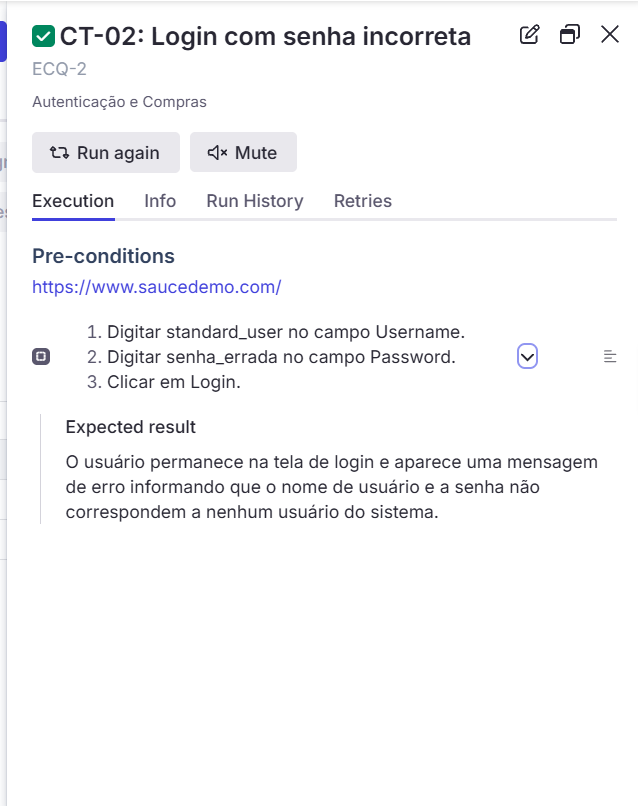
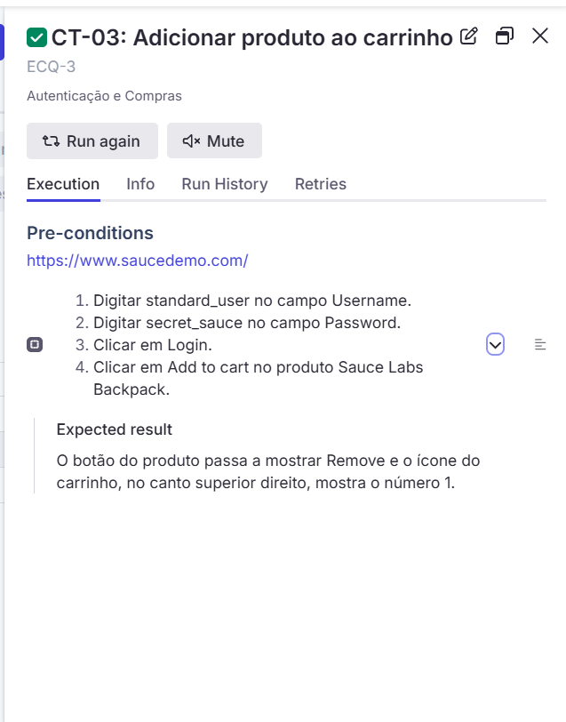
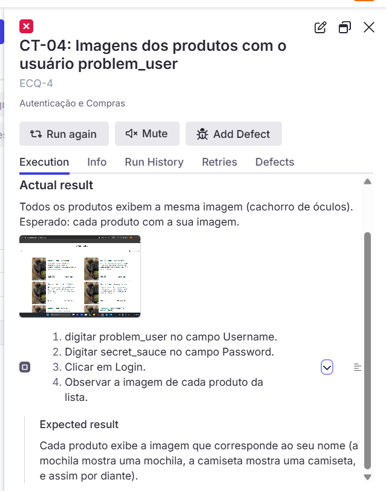
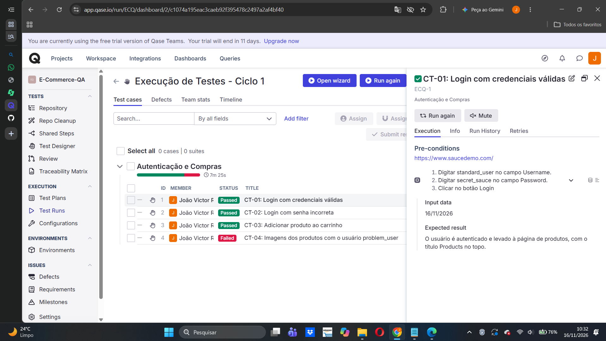

# Atividade: Primeiro Teste de Software 
 
**Estudante:** [seu nome completo] 
**Curso e período:** Bacharelado em Sistemas de Informação, 8º período 
**Disciplina:** Teste de Software 
 
## Sistema testado 
SauceDemo (https://www.saucedemo.com/) 
 
## Classificação do teste realizado 
[Resposta da pergunta 5: nível, objetivo, visão do código, execução, modo e motivo, 
com uma frase de justificativa em cada] 
 
## Casos de teste 
 
 
 
 
 
## Execução 
 
 
## Defeito encontrado 
https://github.com/VictorNix/-relatorio-de-bugs-lab/issues/1#issue-6391847153
 
## Respostas às perguntas para refletir 
1. Por que o resultado esperado é escrito antes de executar o teste? O resultado esperado deve ser definido antes da execução do teste para evitar o viés de confirmação e impedir que erros sejam considerados comportamentos normais. Ele deve ser baseado nas regras e especificações do sistema, e não apenas no que aparece na tela, garantindo uma comparação neutra e objetiva entre o comportamento esperado e o resultado realmente apresentado pelo software.

2. Qual a diferença entre o caso de teste (CT-04) e o relatório de defeito (a issue)? 
Por que precisamos dos dois? O caso de teste (CT-04) é o planejamento que define previamente as etapas, as pré-condições e os resultados esperados do sistema. Já o relatório de defeito (issue no GitHub) registra os erros encontrados durante a execução, apresentando evidências, ambiente de teste, severidade e prioridade para facilitar sua correção. Ambos são importantes para garantir a rastreabilidade e a organização da qualidade do software, pois o caso de teste orienta o que deve ser verificado, enquanto a issue documenta e direciona a resolução dos problemas, permitindo acompanhar se as falhas foram corrigidas.

3. Quatro casos passaram ou falharam. Podemos afirmar que a loja não tem mais nenhum defeito além do que você encontrou? Justifique.
Não é possível afirmar que o sistema está livre de erros, pois os testes apenas identificam a presença de defeitos, não garantindo sua ausência. Como quatro casos de teste abrangem apenas uma pequena parte das funcionalidades da loja, outras áreas, como checkout, cadastro, filtros, usabilidade, desempenho e segurança, ainda podem apresentar falhas não identificadas.
 
4. Se essa loja fosse da sua empresa, o que você testaria a seguir? Realizaria os testes de desempenho e segurança para verificar se o site responde rapidamente, suporta muitos usuários simultâneos e protege os dados pessoais e financeiros dos clientes contra invasões e vazamentos. Também seria necessário testar o fluxo completo de checkout, incluindo pagamentos e cálculo de frete, além de garantir uma boa experiência de navegação e compra em dispositivos móveis.
 
5. Classifique o teste deste guia nos seis critérios da seção 1.1 (nível, objetivo, visão do código, execução, modo e motivo) e justifique cada resposta em uma frase.
- **Nível: Sistema** — O teste atua na loja inteira através do navegador, avaliando o software completo da perspectiva de um cliente.

- **Objetivo: Funcional** — O teste verifica se as funcionalidades da loja (como login e adição de produtos ao carrinho) fazem o que deveriam fazer.

- **Visão do código: Caixa-preta** — A validação é realizada observando apenas as telas e resultados visíveis, sem acesso ou leitura do código-fonte.

- **Execução: Dinâmico** — O teste exige a execução do sistema em tempo real e a interatividade com a loja em funcionamento.

- **Modo: Manual** — Os passos de teste são executados e conferidos diretamente por uma pessoa, sem a utilização de scripts automatizados.
- **Motivo: Teste novo** — Trata-se da primeira rodada de execução dos casos de teste (que passaria a ser um teste de regressão se repetido após alterações no código).

6. O teste realizado no guia não é unitário nem de carga, pois é executado no nível de sistema, por meio da interface do navegador, avaliando o funcionamento da loja como um todo, sem acessar o código-fonte. Além disso, é realizado por um único usuário, sem avaliar o desempenho do servidor diante de vários acessos simultâneos.
